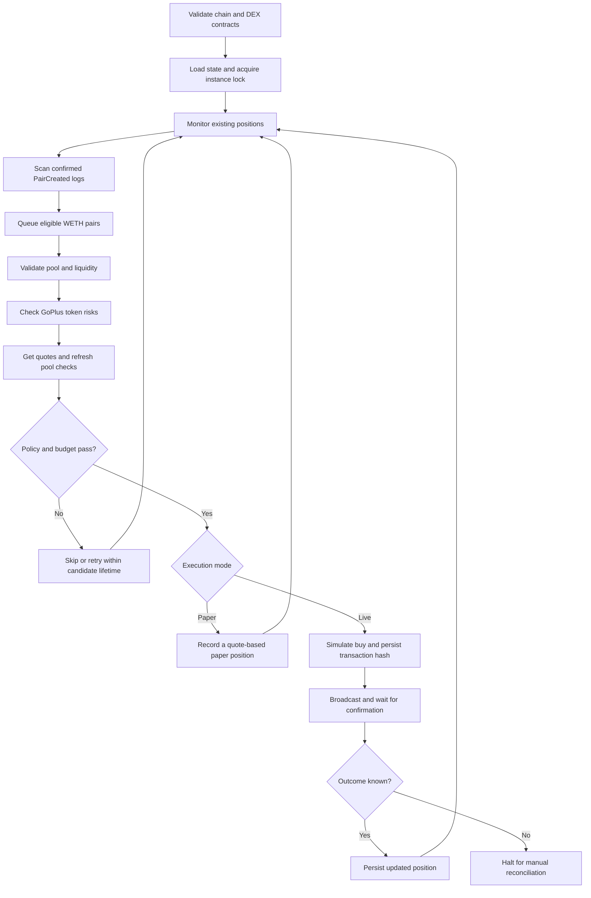

<div align="center">

# Robinhood Meme Sniper Bot

**Discover new pools. Inspect token risks. Execute with defined limits.**

A modular TypeScript trading bot for new WETH pairs on Robinhood Chain.


[Overview](#overview) · [Quick Start](#quick-start) · [Running the Bot](#running-the-bot) · [Configuration](#configuration) · [Troubleshooting](#troubleshooting)

</div>

> [!IMPORTANT]
> **Paper trading is enabled by default.** Paper mode does not send real transactions. Live execution is implemented, but real-money buy/sell execution has not been validated during delivery. Security checks reduce exposure; they do not guarantee safety, sellability, or profit.

## Overview

Robinhood Meme Sniper watches a configured Uniswap V2 Factory for newly created trading pairs, evaluates eligible WETH pools, and enters only when its security policy, liquidity requirements, and position limits allow it. Positions are monitored for take-profit, stop-loss, and maximum holding time exits.

The bot is designed as a readable, modular starting point for inspecting and operating a new-pool strategy. It uses confirmed HTTP log polling and persistent cursors. It does not promise first-block execution or compete for pending-transaction ordering.

### Feature Highlights

| Area | Included capabilities |
| --- | --- |
| Discovery | `PairCreated` monitoring, block-range catch-up, candidate expiry, queue limits, and deduplication |
| Token screening | Mandatory GoPlus checks, verified source requirement, explicit zero-tax policy, and reported holder concentration checks |
| Pool inspection | Factory/pair identity checks, WETH reserve threshold, input-to-reserve limit, and on-chain burned LP measurement |
| Execution | Paper mode, live buy/sell paths, quote slippage limits, static calls, gas estimates, and exact-amount sell approvals |
| Position management | Take-profit, stop-loss, holding timeout, simultaneous-position cap, and daily entry budget |
| Recovery | Atomic state replacement, separate paper/live state, single-instance locks, and transaction hashes persisted before broadcast |
| Operations | Read-only preflight, token inspection command, a live terminal dashboard, structured JSON logs, and a stop-file mechanism |

### Supported Scope

| Supported | Outside the current implementation |
| --- | --- |
| Robinhood mainnet, chain ID `4663` | Other networks |
| Configured Uniswap V2-compatible Factory/Router | Uniswap V3/V4 and launchpad bonding curves |
| Direct WETH/token pairs | USDT/USDG pairs and multi-hop routes |
| Newly created pools | Proof that the token itself was newly deployed |
| Configurable risk screening | Automatic classification of a token as a meme coin |
| Confirmed-block polling | Mempool sniping, MEV protection, and guaranteed execution priority |

## How It Works



Position checks run before new entry evaluations. If a position quote or exit check fails, the current cycle does not open new positions. Processing is serial: API requests and transaction confirmations can delay checks on other positions.

## Quick Start

### 1. Install prerequisites

Install **Node.js 22 or newer**, npm, and Git. Confirm they are available:

```bash
node --version
npm --version
git --version
```

### 2. Clone the repository


```bash
git clone https://github.com/CypsscreekChant/robinhood-meme-sniper-bot
cd robinhood-meme-sniper-bot
```


### 3. Install dependencies

```bash
npm i
```

### 4. Create your local configuration

On macOS/Linux, copy the template **only if `.env` does not already exist**:

```bash
if [ ! -f .env ]; then
  cp .env.example .env
fi
chmod 600 .env
```

On Windows PowerShell:

```powershell
if (!(Test-Path .env)) {
  Copy-Item .env.example .env
}
```

Open `.env` in your editor. Set `PRIVATE_KEY` to your dedicated wallet private key, and keep paper mode enabled:

```dotenv
MODE=paper
LIVE_TRADING_ACK=
PRIVATE_KEY=0xYOUR_64_HEX_CHARACTER_PRIVATE_KEY
RPC_URL=https://rpc.mainnet.chain.robinhood.com
GOPLUS_APP_KEY=
GOPLUS_APP_SECRET=
GOPLUS_API_TOKEN=
```

Every setting in `.env.example` has an explanation. Replace the private-key placeholder with a valid `0x`-prefixed, 64-character hexadecimal private key. `LIVE_TRADING_ACK` may remain empty in paper mode, and GoPlus authentication can be configured as described below. Never share or commit your key.

### Configure GoPlus Automatic Authentication

Get your App Key and App Secret from the [GoPlus Console](https://console.gopluslabs.io/), then set both in your local `.env`:

```dotenv
GOPLUS_APP_KEY=YOUR_APP_KEY
GOPLUS_APP_SECRET=YOUR_APP_SECRET
GOPLUS_API_TOKEN=
```

The bot obtains an access token on startup and caches it in memory. Before a security request, it renews tokens approaching expiration using the API's `expires_in` value, with up to 60 seconds of safety margin. Renewal happens on demand; no background timer or manual copying is needed. Restarting the process obtains a fresh token.

HTTP 401 or GoPlus code 4023 triggers one token renewal and one retry. Other failures, including quota/rate-limit errors, do not trigger an authentication retry. If renewal or the retried check fails, the candidate is not bought. Concurrent requests share a single token issuance. Startup fails if initial automatic authentication fails.

App credentials take priority over `GOPLUS_API_TOKEN`. Setting only one app credential is an error. If neither is set, a manually supplied token is used without automatic renewal; with all three blank, the bot attempts unauthenticated access where available. Generated tokens are not printed or written into source files or `.env`. App Secret is used locally to calculate the signature, not sent as a request field. Changes to `.env` require restarting the process.

### 5. Validate the project and connection

Run these commands individually and inspect each result:

```bash
npm run typecheck
npm test
npm run build
npm run check
```

`npm run check` is read-only. It verifies the chain ID, deployed contract code, and the Router's Factory/WETH references. It does **not** validate your full trading strategy, GoPlus access, or ability to complete a live swap.

A successful preflight prints a JSON record with `"event":"preflight_ok"` and `"chainId":4663`.

### 6. Start paper trading

```bash
npm start
```

Leave the terminal open. A `started` event confirms the main loop began. The bot then monitors the configured Factory and evaluates eligible candidates as they appear.

**No trade is a valid result.** With the default policy, a candidate must have at least 5 ETH of WETH-side liquidity, at least 95% burned LP, explicit zero buy/sell tax, and complete acceptable security data. Newly launched tokens often fail these requirements.

## Running the Bot

### Command Reference

| Command | What it does |
| --- | --- |
| `npm start` | Starts continuous operation using `MODE` from `.env` |
| `npm run check` | Performs read-only chain and DEX preflight |
| `npm run token -- 0xTOKEN_ADDRESS` | Inspects a token's configured V2 WETH pair and GoPlus report; replace the placeholder with a real address |
| `npm run typecheck` | Checks TypeScript without generating output |
| `npm test` | Runs the automated test suite |
| `npm run build` | Compiles the project into `dist/` |
| `node dist/main.js` | Runs the compiled bot after a successful build |
| `node dist/main.js check` | Runs compiled read-only preflight |

All commands above assume you are in the project directory. The application resolves `.env` and relative `DATA_DIR` paths from that directory, even when the entry point is invoked elsewhere. Existing shell environment variables take precedence over `.env` through dotenv's default behavior.

### Inspect One Token Without Trading

Replace `0xTOKEN_ADDRESS` with the token's full contract address:

```bash
npm run token -- 0xTOKEN_ADDRESS
```

The command checks the configured WETH pair and reports pool reserves, burned LP basis points, and GoPlus rejection reasons. A token without such a pair will fail inspection. An empty GoPlus rejection list is **not** a complete entry approval: the live engine also checks candidate age, pool thresholds, budget, and position limits.

### Understand Paper Mode

Paper mode is the default. It reads real chain data and Router quotes without sending real transactions. Entries and exits are recorded locally using slippage-adjusted quote values.

It does not model transaction ordering, gas costs, MEV, execution failures, or a malicious token's actual sell behavior. AMM fees represented in Router quotes are reflected in those quotes; actual execution costs and outcomes remain untested. Paper results are not expected live returns.

### Enable Live Trading

> [!WARNING]
> Live mode spends real ETH. Use a dedicated trading wallet and keep its private key only in your local `.env`. Do not paste it into source code, issues, logs, screenshots, or chat.

1. Stop any running paper process with **Ctrl+C**.
2. Review your RPC, DEX addresses, trade size, daily budget, position limits, and exit settings.
3. Fund the dedicated wallet with native ETH on **Robinhood mainnet** for entry principal and gas.
4. Edit the following values in `.env`:

```dotenv
MODE=live
LIVE_TRADING_ACK=I_UNDERSTAND
# Replace with 0x followed by the dedicated wallet's 64 hexadecimal private-key characters.
PRIVATE_KEY=0xYOUR_64_HEX_CHARACTER_PRIVATE_KEY
# Use your Robinhood mainnet HTTP(S) provider URL for sustained operation.
RPC_URL=https://YOUR_ROBINHOOD_MAINNET_RPC
```

The two placeholder values above are deliberately nonfunctional: replace them locally. Do not put a seed phrase or public wallet address in `PRIVATE_KEY`.

5. Run preflight, then start the process:

```bash
npm run check
npm start
```

Confirm the startup record says `"mode":"live"` and shows the expected public wallet address. The bot can buy automatically when a candidate passes; there is no per-trade confirmation prompt.

Live mode and paper mode use separate state files. Switching modes does not convert paper positions into live holdings. The wallet should not be shared with another transaction-sending program: pending wallet transactions cause this bot to refuse a new send.

Each live send checks gas price, estimated transaction cost, and remaining ETH reserve. Those limits also apply to approvals and exits, so limits that are too restrictive can prevent selling. Approvals are for the amount being sold, not an unlimited allowance.

### Follow the Logs

With the default `LOG_FORMAT=auto`, an interactive terminal opens a live dashboard with a cyan header, a prominent PAPER/LIVE indicator, elapsed runtime, scanned block and confirmed target, time since the last successful scan, candidate queue, positions, daily entry budget, session counters, and recent events. The screen refreshes every second without making extra RPC requests. Smaller terminals use a compact layout. `NO_COLOR=1` disables color styling.

A moving indicator means the interface is refreshing, not that the RPC has returned successfully. Check **Last scan** and the delayed-scan warning to distinguish an idle market from a slow or stalled operation. Pool/rejection/trade/error counters cover the current process session; rejection counts include repeat assessments. Displayed position costs are entry principal, not current value or profit.

The terminal view uses an alternate screen and restores the cursor and original screen on normal exit, leaving recent events in scrollback. If the process is forcibly killed and your cursor remains hidden, run `printf '\033[?25h\033[?1049l'` in your terminal.

Choose the format in `.env`:

```dotenv
# auto: dashboard in an interactive terminal; JSON when piped or redirected
LOG_FORMAT=auto
```

- `auto`: live dashboard for interactive terminals; JSON for redirected output.
- `json`: structured event records, including in an interactive terminal.
- `pretty`: dashboard in an interactive terminal; readable event lines when redirected.

Piped or redirected output includes a heartbeat about every 30 seconds after state initialization, even if no new pools appear. npm may also print its command banner. Common events include:

| Event | Meaning |
| --- | --- |
| `preflight_ok` | Read-only chain and DEX validation passed |
| `started` | Continuous operation began |
| `heartbeat` | Periodic progress snapshot in non-dashboard output |
| `new_pair` | An eligible pair was added to the candidate queue |
| `candidate_rejected` | A candidate failed one or more policy rules |
| `candidate_check_failed` | A candidate inspection encountered an error; no entry is made for that attempt |
| `candidate_queue_full` | A newly discovered candidate was dropped because the queue was full |
| `buy` / `sell` | A paper operation was recorded or a live operation completed |
| `transaction_submitted` | A live transaction was broadcast; its hash is included |
| `exit_check_failed` | A position could not be checked or exited; new entries are blocked for that cycle |
| `cycle_failed` | The loop encountered an error and will retry if no transaction is pending |
| `pending_transaction_halt` | An unresolved transaction requires reconciliation |
| `emergency_stop` | A STOP file was detected |
| `fatal` | Startup or execution failed; inspect the configuration and state guidance below |

Example log shape, with illustrative values:

```json
{"time":"2026-10-29T00:00:00.000Z","event":"candidate_rejected","token":"0x...","reasons":["..."]}
```

Event names and configuration comments are English. Some detailed rejection messages in the current implementation are Chinese. Raw RPC error payloads are suppressed because they can contain credentials or signed transaction data.

On macOS/Linux, keep a local session log while viewing output:

```bash
mkdir -p logs
npm start 2>&1 | tee -a logs/session.log
```

Stop this foreground process using Ctrl+C. Log files are ignored by the supplied `.gitignore`. Logs are not rotated automatically; monitor disk usage.

### Stop and Restart

**Normal stop:** press **Ctrl+C**. The process waits for the active operation to finish; this is not an instantaneous cancellation of in-flight work.

**Stop file:** from another terminal, using the default `DATA_DIR`:

```bash
mkdir -p data
touch data/STOP
```

The bot checks this file before a new buy and at the beginning of its next loop. Already broadcast transactions cannot be cancelled by the stop file. If you changed `DATA_DIR`, create `STOP` inside that configured directory instead.

Before restarting:

```bash
rm -f data/STOP
npm start
```

Stopping does **not** liquidate open positions. While stopped, no take-profit, stop-loss, or holding-time checks run. A normal restart resumes saved positions and the saved discovery cursor.

## Security Policy

The entry policy is deliberately restrictive. Unknown critical data is treated as a reason to skip a candidate.

| Check | Entry requirement |
| --- | --- |
| Network and contracts | Chain ID `4663`; Factory, Router, and WETH contain code; Router references match configuration |
| Pair authenticity | `token0`, `token1`, `factory`, and `Factory.getPair` match the expected direct WETH pair |
| Liquidity | WETH-side reserve meets the configured minimum |
| Pool sizing | Entry amount / WETH reserve stays within the configured basis-point limit |
| LP supply | Minimum proportion is held by the zero/dead burn addresses, read directly from the pair |
| Source verification | GoPlus explicitly reports verified/open source |
| Contract behavior | Required honeypot, restriction, proxy, mint, ownership, balance-changing, pause, blacklist, whitelist, tax-changing, cooldown, and related fields explicitly report zero risk flags |
| Transfer taxes | Both buy and sell tax must be explicitly zero |
| Holder concentration | Reported holder data is present; non-exempt addresses remain below the configured threshold |
| Quote path | Both entry and reverse Router quotes exist and return positive output |
| Final refresh | Pool reserve and burned LP checks are repeated after the remote security request |

Time-locked LP is not counted as burned LP. Burned LP does not prevent malicious token behavior, supply changes, or holder dumps. Holder checks exclude the current pair and two burn addresses; provider coverage, delayed data, and balances split across addresses limit this check.

A reverse Router quote is **not** proof of sellability. Before entry, sellability screening relies on GoPlus. Live buys use a static call and gas estimation; actual sells are statically simulated from the holding wallet when an exit is attempted. This implementation does not perform a full buy-then-sell simulation against one forked state.

## Configuration

The complete, commented template is [`.env.example`](.env.example). **ETH values are native ETH amounts, not USD.** `100 bps = 1%`.

### Connection and Execution

| Variable | Default | Purpose |
| --- | --- | --- |
| `MODE` | `paper` | `paper` or `live` |
| `LIVE_TRADING_ACK` | Empty | Must equal `I_UNDERSTAND` for live mode |
| `PRIVATE_KEY` | Empty | Your wallet private key: `0x` followed by 64 hexadecimal characters |
| `RPC_URL` | Official public RPC | Robinhood mainnet HTTP(S) endpoint |
| `GOPLUS_APP_KEY` | Empty | GoPlus App Key; pair with App Secret for automatic token renewal |
| `GOPLUS_APP_SECRET` | Empty | GoPlus App Secret used to sign token requests locally |
| `GOPLUS_API_TOKEN` | Empty | Optional manual token; ignored when app credentials are configured |
| `FACTORY_ADDRESS` | Official V2 deployment | Factory monitored for new pairs |
| `ROUTER_ADDRESS` | Official V2 deployment | Router used for quotes and swaps |
| `WETH_ADDRESS` | Robinhood WETH | Quote-side wrapped native token |
| `DATA_DIR` | `data` | Relative to the project root, or an absolute directory |
| `LOG_FORMAT` | `auto` | Interactive dashboard or redirected JSON; also accepts `pretty` and `json` |

### Entry Limits and Safety

| Variable | Default | Meaning |
| --- | ---: | --- |
| `BUY_ETH` | `0.001` | Entry principal per purchase, excluding gas |
| `MAX_DAILY_BUY_ETH` | `0.01` | Cumulative entry principal per UTC day; selling does not restore allowance |
| `MAX_POSITIONS` | `3` | Maximum simultaneously tracked positions |
| `MIN_LIQUIDITY_ETH` | `5` | Minimum WETH-side reserve |
| `SLIPPAGE_BPS` | `100` | 1% allowance from the Router quote |
| `MAX_PRICE_IMPACT_BPS` | `100` | Maximum input/reserve ratio; a conservative pool-size guard |
| `MAX_HOLDER_BPS` | `1000` | 10% maximum per reported non-exempt holder |
| `MIN_BURNED_LP_BPS` | `9500` | At least 95% burned LP supply |

### Gas and Exit Rules

| Variable | Default | Meaning |
| --- | ---: | --- |
| `MAX_GAS_GWEI` | `2` | Maximum gas price for live sends |
| `MAX_TX_FEE_ETH` | `0.0005` | Maximum estimated cost per transaction, including approvals |
| `GAS_RESERVE_ETH` | `0.003` | Required ETH remaining after the estimated value and fee |
| `TAKE_PROFIT_BPS` | `5000` | Exit at a 50% gain relative to entry principal |
| `STOP_LOSS_BPS` | `2000` | Exit at a 20% loss relative to entry principal |
| `MAX_HOLD_SECONDS` | `3600` | Attempt to exit after one hour |

Exit thresholds compare the slippage-adjusted sell quote with entry principal. They exclude gas and are **not net-profit calculations**. A timeout exit still requires a valid quote and executable sell. Price gaps, restrictions, liquidity loss, network errors, and gas limits may prevent any exit.

### Discovery and Timing

| Variable | Default | Meaning |
| --- | ---: | --- |
| `POLL_MS` | `3000` | Wait after each completed loop; actual interval also includes API and receipt waits |
| `CONFIRMATIONS` | `3` | Confirmation depth used for discovery and receipts |
| `BLOCK_CHUNK` | `100` | Maximum block range scanned per iteration |
| `LOOKBACK_BLOCKS` | `100` | Initial history when there is no saved cursor |
| `CANDIDATE_TTL_SECONDS` | `600` | Candidate expiry from the creation block timestamp |
| `MAX_CANDIDATES` | `200` | Queue capacity; overflow is dropped and logged |

A rejected candidate may be revisited while it remains eligible and unexpired; the retry timestamp is normally advanced by 30 seconds. At most one due candidate is assessed per loop. Confirmation depth reduces exposure to recent reorgs but is not Ethereum finality; deep reorgs remain possible.

## State and Recovery

```text
data/
├── paper.json    # Paper cursor, candidates, positions, budget, and entry history
├── live.json     # Live state and optional pending transaction journal
├── paper.lock   # Paper process lock; contains a PID while active
├── live.lock    # Live process lock; contains a PID while active
└── STOP         # Optional operator-created stop file
```

Files are created as needed. State is written through a temporary file and atomic rename. Each successfully purchased token is recorded to prevent re-entry across restarts. State is tied to the chain, DEX configuration, WETH, and wallet identity. Use a separate `DATA_DIR` when changing those identities. If existing state has a different wallet identity, use a separate directory such as `DATA_DIR=data-wallet` to preserve its history. Do not delete or alter live state to bypass an identity mismatch.

### Unresolved Transactions

The bot signs a transaction and persists its hash **before broadcasting**. An ambiguous broadcast, receipt timeout, reverted receipt, or failed post-trade balance read leaves a `pending` journal entry and halts trading. A restart with that entry also halts.

Do not simply delete `pending`, reset the state, or rerun the trade. Reconcile first:

1. Locate the stored hash and operation kind in the appropriate state file.
2. Check the transaction on the Robinhood explorer or through your RPC provider.
3. Confirm its receipt, wallet nonce, actual token/ETH balances, and relevant allowance.
4. If a buy succeeded, reconcile the position, entry history, and budget before clearing the journal.
5. If a sell succeeded, reconcile the remaining position before clearing the journal. Successful approvals also need their allowance checked.
6. If no transaction can be found, establish whether it can still be pending or propagated before deciding it is safe to retry. An absent explorer result alone does not prove failure.

There is no automatic reconciliation, replacement transaction, gas top-up, or force-sell command. Keep a backup of state before any manual correction. The state file is not a complete accounting ledger; sell logs report a quoted minimum, not exact net proceeds.

### Stale Locks

An abrupt termination can leave a `.lock` file. On startup, the bot checks the stored PID and automatically recovers the lock only when the operating system confirms that the process no longer exists. Active or inaccessible processes block startup with `BOT_ALREADY_RUNNING`. Invalid PID contents require manual inspection. Never remove a lock to bypass an active instance.

Recovery uses a short-lived `.lock.recovery` guard to serialize competing starters. If `LOCK_RECOVERY_BUSY` persists after a crash, verify that no bot or recovery process is running before removing that guard. Recovery does not modify saved positions or transaction journals.

## Troubleshooting

| Symptom | What to check |
| --- | --- |
| `npm` or `node` not found | Install Node.js 22+ and reopen your terminal |
| Dependencies cannot be resolved | Run `npm i` from the project directory |
| Preflight fails | RPC reachability, chain ID, contract addresses, and Router references |
| `INVALID_PRIVATE_KEY` | Please enter a valid private key in `.env` (`PRIVATE_KEY`). Paper mode does not send real transactions. |
| No `new_pair` events | Factory selection, RPC log access, saved cursor, and whether new WETH pairs actually appeared |
| Candidates are always rejected | Read rejection reasons; strict LP, zero-tax, concentration, and complete-data requirements are intentional |
| GoPlus checks fail | Service availability, quota, token coverage, and both App Key/Secret values; failed renewal prevents buying |
| No entry despite a clean report | Candidate age, daily cap, existing entry history, max positions, final pool refresh, and position-monitoring errors |
| Sell/approval fails | ETH reserve, fee ceilings, wallet pending transactions, allowance, token restrictions, and pool liquidity |
| Restart reports pending state | Reconcile the transaction before modifying state; see recovery instructions |
| Changing `LOOKBACK_BLOCKS` has no effect | An existing state file resumes its cursor; the setting applies to new state |
| `STOP` does not stop instantly | An API call or transaction confirmation may still be active |

## Project Structure

```text
robinhood-meme-sniper/
├── src/
│   ├── main.ts                 # CLI, preflight, lifecycle, and stop handling
│   ├── config.ts               # Environment parsing and bounds
│   ├── abi.ts                  # Minimal contract interfaces
│   ├── log.ts                  # Dashboard lifecycle, heartbeat, and event logging
│   ├── ui/
│   │   └── terminal.ts         # Responsive terminal rendering and credential redaction
│   ├── state.ts                # Persistence, locks, budgets, and journals
│   ├── watcher.ts              # Pair discovery and block catch-up
│   ├── engine.ts               # Candidate policy and position orchestration
│   ├── dex/
│   │   └── v2.ts               # Pool identity, reserves, burned LP, and quotes
│   ├── security/
│   │   ├── auth.ts             # Access token caching, renewal, and authentication retry
│   │   ├── goplus.ts           # Security API requests and response validation
│   │   └── policy.ts           # Fail-closed token risk rules
│   └── trading/
│       ├── executor.ts         # Paper/live trades, approvals, and receipts
│       └── rules.ts            # Integer-based slippage and exit calculations
├── tests/
│   ├── terminal.test.ts
│   ├── auth.test.ts
│   ├── config.test.ts
│   ├── security.test.ts
│   └── trading.test.ts
├── .env.example                # Documented configuration template
├── .gitignore                  # Excludes credentials, state, builds, and logs
├── package.json
├── package-lock.json
├── tsconfig.json
└── README.md
```

Local `.env`, generated `data/`, installed `node_modules/`, and compiled `dist/` are excluded from Git.

## Validation Status

The initial implementation passed TypeScript checking, compilation, its automated test suite, a real mainnet read-only preflight, and a short paper-mode watcher smoke check.

Tests also cover private-key validation and paper-mode isolation from transaction signing/broadcasting. Tests cover strict risk flags, missing security data, holder concentration, tax handling, integer exit boundaries, state identity, single-instance locking, paper position persistence, daily budget limits, re-entry prevention, and journal retention after an ambiguous broadcast failure.

These checks do **not** establish live trading profitability or real-world sellability. Live swaps have not been exercised as part of delivery.

## References

- [Robinhood Chain connection details](https://docs.robinhood.com/chain/connecting/)
- [Robinhood token contracts](https://docs.robinhood.com/chain/contracts/)
- [Official Uniswap V2 deployments](https://developers.uniswap.org/docs/protocols/v2/deployments)
- [GoPlus access-token endpoint](https://docs.gopluslabs.io/reference/getaccesstokenusingpost)
- [GoPlus Token Security API](https://docs.gopluslabs.io/reference/tokensecurityusingget_1)
- [GoPlus response field definitions](https://docs.gopluslabs.io/reference/response-details)

